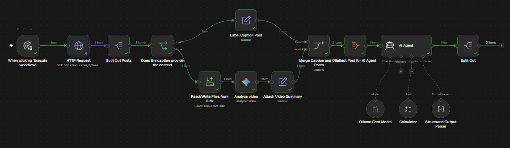

# gta6-content-scout

Built with ChatGPT Codex, this n8n workflow uses the X API to find trending GTA 6 posts. In tests with mock X data, it routes posts by caption length, analyzes clips when the caption is short, and uses an AI agent to suggest a title, opening hook, and video angle.

## n8n workflow

